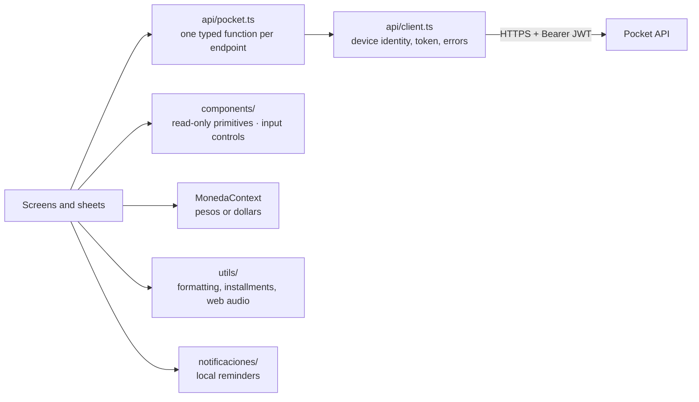

# Pocket

Mobile app for **personal finances with voice logging**: say *"I spent five thousand on pastries and twenty thousand on gas"*, review the expenses the AI detected, and confirm them. Pocket then shows the month by category, flags small repeated "ant" expenses, compares against your historical average, tracks fixed monthly bills and credit card installments, and can display everything in pesos or in the "blue" dollar rate.

Built with React Native and Expo, **without a UI library**: every screen is written by hand against the design mockup. The same code runs on Android, iOS and the web.

**Live demo (web):** [pocket.lautaromoreyra.dev](https://pocket.lautaromoreyra.dev) · Backend: [pocket-api](https://github.com/lautaromoreyraa/pocket-api)


## Screens

| Screen | What it does |
|---|---|
| **Register** | Voice recording and manual entry |
| **Summary** | Month total, spending by category and "ant expense" alerts |
| **Movements** | Every expense of the period |
| **Fixed bills** | Monthly templates and whether each one is paid this month |
| **History** | Comparison against previous months |

Forms open as bottom sheets: manual expense, fixed bill, income, this month's amount, and the **audio confirmation sheet**, where the user reviews what the AI detected before anything is saved.

## Architecture



- **Screens never touch the network layer directly.** They import typed functions from `api/pocket.ts`; only `api/client.ts` knows about the device identity, the token and HTTP errors.
- **`types/` is the contract with the backend**, field by field, plus two client-only draft types for what hasn't been confirmed yet.
- **Bill reminders are local notifications** scheduled on the device, grouped by day of the month: no push tokens and no scheduler on the server.
- **Web audio is converted before upload.** Browsers record WebM/Opus, which the AI provider doesn't accept — and instead of failing, a model that can't decode the audio fabricates expenses. `utils/audioWeb.ts` converts the recording to 16 kHz mono WAV with the Web Audio API, with no dependencies.

## Project structure

```
App.tsx                root: active tab, pending drafts and which sheet is open
src/
├── api/               the only layer that talks to the backend
├── components/        primitives.tsx (read-only) · controls.tsx (inputs) · TabBar, headers, icons
├── context/           MonedaContext, the only global state
├── data/              category icons and colors, demo data for offline development
├── notificaciones/    local reminders for fixed bills
├── screens/           the five screens
├── sheets/            modal forms, built on a generic Sheet container
├── theme/             colors, typography and spacing — no screen defines its own
├── types/             the backend contract
└── utils/             pure functions: formatting, installment preview, web audio
```

## Getting started

**Prerequisites:** Node 20+ and the [Expo Go](https://expo.dev/go) app or an emulator. The backend must be running (see [pocket-api](https://github.com/lautaromoreyraa/pocket-api)).

```bash
npm install
EXPO_PUBLIC_API_URL=http://<your-ip>:8080 npx expo start   # scan the QR code with Expo Go
npx expo start --web                                      # or run it in the browser
```

Setting `USE_MOCKS` to `true` in `src/api/config.ts` runs the whole app against local sample data, without a backend.

Local notifications need a [development build](https://docs.expo.dev/develop/development-builds/introduction/): Expo Go can't load `expo-notifications` on Android, so the module is required lazily and skipped there.

## Deployment

The web demo is a static export (`npx expo export --platform web`) uploaded to Vercel. The production API URL lives in the versioned `.env.production`, which Expo loads on export and inlines as `EXPO_PUBLIC_API_URL`; development keeps the fallback in `src/api/config.ts`.
